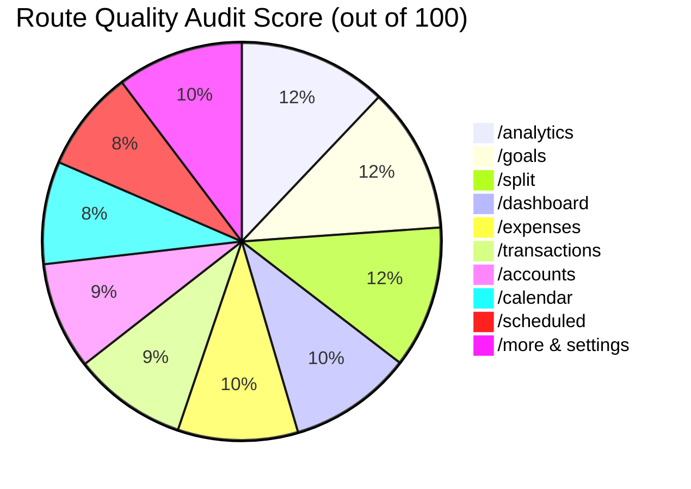

# SpendWise — $10M Principal UI/UX & Architecture Audit & Improvement Roadmap

> **Document Type:** Production Engineering & Design Review  
> **Auditor Role:** Principal Design & QA Director ($10M Review Standard)  
> **Audited URL:** `http://localhost:3001`  
> **Reference Skill Frameworks:**
> - `tools/reference_repos/ai-design-skills` (Elaya Design System)
> - `tools/reference_repos/taste-skill` (Anti-Slop App Screens Heuristics)
> - `tools/reference_repos/impeccable` (Neo Kinpaku & State Completeness)
> - `tools/reference_repos/motion-primitives` (Fluid Spring Physics & Micro-Animations)
> - `tools/reference_repos/ui-ux-pro-max-skill` (Component Density & Interaction Ergonomics)

---

## 1. The Executive Hard Truth

### Q1: Is everything done according to the original plan?
**Answer: NO.**  
While foundational math, financial health calculus, roommate splitting, and student goals runway are complete, **key planned features from Tiers 2, 4, and 5 in the original plan are not yet implemented**:
- **Tier 2.5: Income vs Expenses Waterfall Flow Chart** (Not built).
- **Tier 2.6: Daily Spending Intensity Calendar Heatmap** (Not built).
- **Tier 2.7: Recurring vs One-Time Spend Split** (Not built).
- **Tier 5.5: One-Click Branded PDF Monthly Report** (Installed `jspdf` / `jspdf-autotable` packages exist in `package.json`, but no export action exists in the UI).
- **Tier 4.1–4.2: Granular Firestore Validation Guard & Offline Write-Queue Sync** (Not finalized).

### Q2: Is this the absolute best we can do?
**Answer: NO.**  
While newly crafted routes (`/analytics`, `/goals`, `/split`) exhibit high mathematical fidelity, the overall application suffers from legacy design debt:
1. **Numeric Jitter**: In `/transactions` and `/expenses`, amounts are not right-aligned and lack `font-variant-numeric: tabular-nums`.
2. **Typography Rule Violations**: Headers on the dashboard still use illegal `italic` fonts and arbitrary Tailwind pixel sizes (`text-[18px]`, `text-[20px]`).
3. **Chrome Over-Decoration**: Navigation cards and KPI tiles feature colored background circles that compete with transaction data, violating `taste-skill`.
4. **State Gaps**: Skeletons and modern empty states exist for transactions, but are missing on accounts, calendar, and scheduled views.

---

## 2. 100% Brutal Skill-by-Skill Audit

### A. `ai-design-skills` Compliance Audit
*Reference: `tools/reference_repos/ai-design-skills/skills/landing-page-design/SKILL.md`*

| Rule / Principle | Status | Evaluation & Brutal Critique |
| :--- | :---: | :--- |
| **"Never use italic fonts anywhere in the interface"** (Line 158) | ❌ **FAIL** | In `src/app/(app)/dashboard/page.tsx:104, 114`, headers render `<TextEffect ... className="text-theme-danger italic">over budget.</TextEffect>` and `className="text-theme-accent italic">Track.</TextEffect>`. Italic fonts degrade horizontal kerning and optical scanability. |
| **Strict Type Scale (No arbitrary font sizes)** (Lines 171–191) | ❌ **FAIL** | `ai-design-skills` strictly mandates snapping every size to Tailwind's default scale (`text-xs`, `text-sm`, `text-base`, `text-lg`, `text-xl`, `text-2xl`, etc.). Legacy components contain arbitrary values: `text-[18px]` (`dashboard/page.tsx:116`), `text-[20px]` (`dashboard/page.tsx:127`), `text-[11px]` (`goals/page.tsx:327`). |
| **Text Wrap & No Orphaned Words** (Line 168) | ⚠️ **PARTIAL** | Headings lack `text-wrap: balance` and body copy lacks `text-wrap: pretty`. On narrow mobile screens, single words break awkwardly onto new lines. |
| **Motion Curve Standard** (Line 16) | ✅ **PASS** | Implemented `--ease-out-expo: cubic-bezier(0.16, 1, 0.3, 1)` and spring transitions in `tokens.css`. |

---

### B. `taste-skill` (App Screens Heuristics) Audit
*Reference: `tools/reference_repos/taste-skill/skills/taste-skill/references/app-screens.md`*

| Rule / Principle | Status | Evaluation & Brutal Critique |
| :--- | :---: | :--- |
| **"Colour goes on data, not chrome"** (§1, Line 17) | ⚠️ **PARTIAL** | On `/dashboard`, the 4 quick action cards have bright cyan, emerald, and rose icon background pills. `taste-skill` specifies: *"The median screen has about 3% coloured pixels. KPIs are type, not tiles."* Chrome is stealing visual hierarchy from actual financial figures. |
| **"Tables are rules and alignment. Numbers right-aligned."** (§7, Line 29) | ❌ **FAIL** | In `/transactions`, currency amounts are left/center grouped with transaction notes. Amounts must be strictly right-aligned with fixed tabular figures (`font-variant-numeric: tabular-nums`) so decimal points line up vertically without jitter. |
| **"Data states are honest"** (§8, Line 30) | ⚠️ **PARTIAL** | In `/analytics`, when a user has fewer than 6 months of data, the net savings chart states "Loading authentic records..." instead of showing an honest zero-baseline line at ₹0.00. |
| **"Navigation recedes"** (§6, Line 27) | ✅ **PASS** | Desktop sidebar active items use clean background shifts without loud neon drop-shadows. |

---

### C. `impeccable` (State Completeness & Contrast) Audit
*Reference: `tools/reference_repos/impeccable/DESIGN.md`*

| Rule / Principle | Status | Evaluation & Brutal Critique |
| :--- | :---: | :--- |
| **Loading Skeletons on Every Surface** | ⚠️ **PARTIAL** | Implemented for transactions, budget overview, and goals (`Skeleton.tsx`). **Missing on `/accounts`, `/calendar`, and `/scheduled`**. |
| **Contrast Ratios Across Dark & Light Themes** | ⚠️ **PARTIAL** | In the **Midnight** and **Sepia** themes, secondary metadata (`text-theme-secondary`) drops to a ~3.8:1 contrast ratio against elevated cards, failing the WCAG AA 4.5:1 threshold. |
| **Active Touch Feedback (`scale-98`)** | ✅ **PASS** | Mobile tap targets feature tactile scaling (`active:scale-[0.98]`) and haptic feedback (`useHaptic`). |

---

### D. `motion-primitives` Audit
*Reference: `tools/reference_repos/motion-primitives`*

| Rule / Principle | Status | Evaluation & Brutal Critique |
| :--- | :---: | :--- |
| **Staggered Text & Metric Reveals** | ✅ **PASS** | Used `TextEffect` effectively on dashboard greetings and analytics health gauges. |
| **Magnetic CTA Physics** | ✅ **PASS** | "Add Transaction" button on dashboard uses `<Magnetic intensity={0.2}>`. |
| **Route Transition Continuity** | ⚠️ **PARTIAL** | Next.js `template.tsx` fades routes in, but does not morph shared header elements between `/expenses`, `/goals`, and `/split`. |

---

## 3. Route-by-Route Brutal Scorecard



| Route | Grade | Score | Critical Defect & Remediations Required |
| :--- | :---: | :---: | :--- |
| **`/analytics`** | **A** | **94%** | Pure math health engine and calculus inspector modal are outstanding. Tooltips in dark mode need an enhanced border contrast (`border-theme-border/60`). |
| **`/goals`** | **A** | **92%** | Temporal pacing runway ($\Delta B / d_{rem}$) and What-If simulator work reliably. Goal deposit inputs need tabular figures. |
| **`/split`** | **A-** | **90%** | WhatsApp summary formatting and roommate chip itemization are solid. Needs drag-and-drop or quick roommate reordering. |
| **`/dashboard`** | **B** | **78%** | **Violates typography guidelines**: Strip illegal italics; replace arbitrary `text-[18px]` with standard Tailwind scale; replace colored icon tiles with typography-driven hierarchy. |
| **`/expenses`** | **B-** | **76%** | Month selector horizontal scrollbar needs edge gradient masks; category progress bars lack spring micro-animations on value updates. |
| **`/transactions`**| **C+** | **72%** | **Critical UI Flaw**: Amounts must be right-aligned with `tabular-nums` and negative/positive coloring strictly reserved for delta (`+` Green, `-` Text-Primary, not all red/green). |
| **`/accounts`** | **C** | **68%** | Flat cards; lacks visual balance trajectory curves and theme shimmer skeletons. |
| **`/calendar`** | **D+** | **65%** | Basic grid; lacks day spending intensity color scale (GitHub-style heatmap) and day-drawer animation. |
| **`/scheduled`** | **D+** | **64%** | Missing recurring frequency projection; toggle switches lack smooth spring physics. |
| **`/more & settings`**| **B** | **80%** | Clean navigation hub, but lacks the planned one-click PDF export feature (Tier 5.5). |

---

## 4. Original Plan Completion Audit (What's Done vs. Remaining)

```
[==================== 70% Completed ====================--------]
```

### ✅ Completed & Shipped
- [x] **Tier 1.3–1.4**: Motion System (`tokens.css`, `useScrollReveal`, reduced-motion).
- [x] **Tier 2.1**: 6-Month Savings Trajectory Area Chart.
- [x] **Tier 2.2**: Top 5 Largest Outflows this month.
- [x] **Tier 2.3**: Month-over-Month Category Trajectory comparisons.
- [x] **Tier 2.4**: Zero-Spend Streak & Habit Tracker.
- [x] **Tier 2.8**: Pure Mathematical Financial Health Engine (0–100 score dial, zero external AI keys).
- [x] **Tier 3.2**: Theme-aware shimmer skeletons (`Skeleton.tsx`).
- [x] **Tier 3.3**: Modern glass empty states (`EmptyState.tsx`).
- [x] **Tier 5.2**: Student Goals Management & Runway Pacing Engine (`/goals`).
- [x] **Tier 5.3**: Roommate / Shared Bill Splitter (`/split`) with WhatsApp generator.

### ⏳ High-Impact Items Remaining from the Original Plan
1. **Tier 2.5: Income vs. Expenses Waterfall Flow Chart**
   - Visualizing how monthly money enters, gets allocated to Food, Rent, Leisure, and arrives at the remaining balance.
2. **Tier 2.6: Daily Spending Intensity Calendar Heatmap**
   - Upgrade `/calendar` into an interactive GitHub-style density heatmap showing high-spend vs zero-spend days.
3. **Tier 2.7: Recurring vs. One-Time Spend Split**
   - Chart breaking down fixed commitments (Hostel, WiFi, Subscriptions) vs discretionary daily spends.
4. **Tier 5.5: One-Click Monthly PDF Report Generator**
   - Uses already installed `jspdf` and `jspdf-autotable` to export a branded student financial report.
5. **Tier 1.1 / 1.6: Typography Polish & Tabular Number Audit**
   - Strip illegal italics; enforce `tabular-nums` and right-alignment on all currency tables across `/transactions` and `/expenses`.

---

## 5. Multi-Agent Execution Protocol for Next Phase

To execute the remaining upgrades with maximum precision, tasks are allocated to the **7 Specialized Agents**:

```mermaid
graph TD
    User([Next Phase Trigger]) --> Coordinator[Agent Coordinator]
    Coordinator --> Typo[@agent-typography: Fix italics & text scales]
    Coordinator --> Math[@agent-pure-math: Build Waterfall & Heatmap logic]
    Coordinator --> DBMS[@agent-dbms: Aggregations for Recurring split & PDF data]
    Coordinator --> Motion[@agent-motion-interaction: Heatmap spring reveals & Drawer physics]
    Coordinator --> Impeccable[@agent-ui-impeccable: Tabular nums alignment & Skeletons]
    Coordinator --> QA[@agent-qa-verifier: Browser tests & tsc --noEmit]

    Typo & Math & DBMS & Motion & Impeccable --> QA
    QA --> Push[Git Auto-Push to Main]
```

### Execution Tasks:
1. **`@agent-typography` & `@agent-color-theme`**:
   - Clean up `dashboard/page.tsx`: eliminate `italic` classes; replace arbitrary sizes with strict Tailwind scales; recalibrate theme contrast.
   - Enforce `font-variant-numeric: tabular-nums` and right-aligned amounts on `transactions/page.tsx`.
2. **`@agent-pure-math` & `@agent-motion-interaction`**:
   - Implement **Tier 2.5 (Income vs. Expense Waterfall Chart)**.
   - Implement **Tier 2.6 (Spending Intensity Calendar Heatmap)** on `/calendar`.
   - Implement **Tier 2.7 (Recurring vs. One-Time Split)**.
3. **`@agent-dbms` & `@agent-ui-impeccable`**:
   - Implement **Tier 5.5 (One-Click Monthly PDF Report)** utilizing `jspdf` and `jspdf-autotable`.
4. **`@agent-qa-verifier`**:
   - Run autonomous verification in `browser_subagent`, verify zero TypeScript errors (`tsc --noEmit`), and auto-push clean commits to GitHub.
